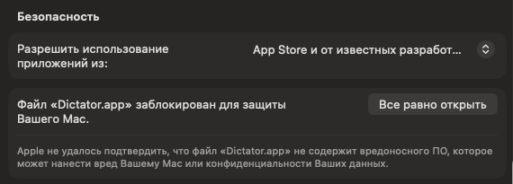

# Dictator

Диктовка для мака: держите F5 🎤 и говорите — текст появится там, где курсор.

Нужен мак на Apple Silicon (M1 и новее) с macOS 26 или новее.

## Установка

1. Скачайте **[Dictator.dmg](https://github.com/AndrewYakovlev/dictator-releases/releases/latest/download/Dictator.dmg)**. Ссылка постоянная: по ней всегда последняя версия.
2. Откройте его и перетащите Dictator в «Программы».

Запускайте Dictator из «Программ», а не прямо из окна `.dmg`: иначе он не будет обновляться и запускаться при входе в систему.

## Первый запуск

Dictator подписан своим сертификатом, а не сертификатом Apple, поэтому в первый раз macOS его не откроет. Это нужно сделать один раз:

1. Откройте Dictator из «Программ». macOS покажет «Файл «Dictator.app» не был открыт» — закройте это сообщение кнопкой «Готово».
2. Откройте «Системные настройки → Конфиденциальность и безопасность» и прокрутите вниз до раздела «Безопасность». Рядом со строкой «Файл «Dictator.app» заблокирован для защиты Вашего Mac» нажмите «Все равно открыть» и введите пароль от мака.
3. macOS ещё раз спросит, открыть ли Dictator, — снова нажмите «Все равно открыть».

   Кнопка появляется после попытки открыть Dictator и доступна около часа. Если её нет — снова откройте Dictator из «Программ» и вернитесь в настройки.

   

Ctrl-клик → «Открыть» с macOS 15 не работает. На macOS 26 и 27 шаги одинаковые.

Дальше откроется окно приветствия: разрешите микрофон и Универсальный доступ, выберите режим («Локально» или «Grok») и попробуйте диктовку прямо в окне. После этого Dictator живёт в строке меню.

## Обновления

Dictator обновляется сам. Раз в 6 часов он проверяет, нет ли новой версии, скачивает её и ставит, когда вы не диктуете хотя бы 10 минут; или сразу — кнопкой «Обновить до …» внизу настроек. Разрешения и настройки при обновлении сохраняются.

### Если Dictator не обновляется

Сначала закройте Dictator: щёлкните его значок в строке меню и нажмите «Выйти» внизу панели. Затем скачайте [Dictator.dmg](https://github.com/AndrewYakovlev/dictator-releases/releases/latest/download/Dictator.dmg) заново и перетащите Dictator в «Программы», заменив старую копию. Настройки и история сохранятся. Если macOS снова не откроет Dictator, повторите шаги из «Первого запуска».
